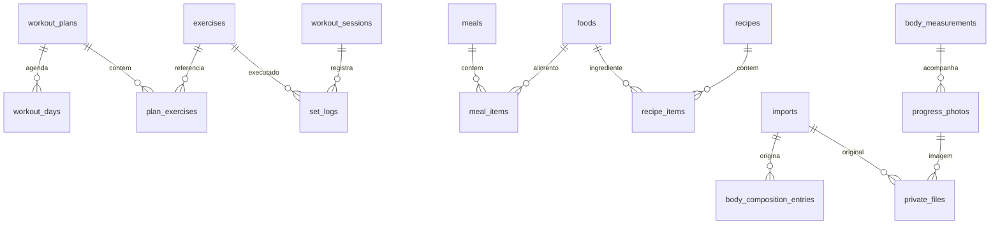

# Modelo de dados — versão 1

O esquema executável está em `server/schema.sql`. Nesta fase, somente treino e autenticação têm rotas e interface. Tabelas reservadas não indicam funcionalidades entregues.

`exercises`, `workout_plans` e `workout_sessions` possuem UUID/ID, revisão e payload criptografado. `workout_days`, `plan_exercises` e `set_logs` são projeções relacionais atualizadas na mesma transação do agregado; não são fontes de escrita independentes. Identificadores dos exercícios de catálogo são estáveis.

O payload de cada sessão de força conserva o nome da ficha, nomes dos exercícios, a faixa de repetições, o descanso e as séries planejadas/concluídas. Editar uma ficha não altera o passado. O vínculo lógico `planId` está no payload criptografado; a sessão não depende de uma ficha permanecer visível. Arquivar uma ficha não exclui dados.

Cada série guarda UUID, carga total (kg), repetições e instante de conclusão ou null. Os instantes ISO estão em UTC; o aparelho faz a apresentação local. `restUntil` é um instante absoluto, para o cronômetro continuar correto após recarregar. Cardio guarda atividade, minutos, quilômetros e esforço (1–10).

`sync_operations` guarda UUID e SHA-256 da operação confirmada. A versão esperada evita atualizações perdidas entre aparelhos. Lotes inteiros têm rollback em conflito; o cliente só descarta operações após confirmação e persistência do novo snapshot criptografado. Reenviar um UUID com conteúdo diferente é rejeitado.

`app_user` tem um único registro (CHECK id=1), salt e hash scrypt. `auth_sessions` guarda apenas hashes de tokens e expiração. A chave AES do servidor fica em arquivo privado separado. IV aleatório de 96 bits por criptografia e tag de autenticação de 128 bits detectam corrupção de conteúdo.

As tabelas futuras são `foods`, `meals`, `meal_items`, `recipes`, `recipe_items`, `daily_goals`, `body_measurements`, `body_composition_entries`, `progress_photos`, `goals`, `imports`, `private_files`. Elas reservam relações e payload criptografado; a especificação detalhada, índices de busca e migrações dessas fases serão adicionados com seus casos de uso. Fotos/originais não terão URLs públicas. Os testes do parser de importação pertencem à Fase 4, quando ele existir.

## Hospedagem gratuita com PostgreSQL

O esquema equivalente está em `server/schema-postgres.sql`. `PostgresStore` implementa o mesmo contrato da API que o SQLite local. Payloads continuam usando AES-256-GCM; a chave vem do segredo privado estável `PIPSFIT_ENCRYPTION_KEY`, sem arquivo no disco temporário da hospedagem. `app_metadata` contém um verificador autenticado para detectar uma chave incorreta antes de qualquer alteração nos registros.

No PostgreSQL, transações com advisory lock serializam as gravações do usuário e a criação inicial da conta. Snapshots usam isolamento REPEATABLE READ. Uma fila pode conter várias revisões de um registro: todas são validadas em ordem, e a versão final e todos os recibos são persistidos atomicamente. As projeções usam inserções em lote. As colunas `position` preservam a ordem de inserção sem depender de rowid do SQLite.

O modo local e seus arquivos existentes não são migrados automaticamente. Consulte `docs/hospedagem-gratuita.md` antes de ativar a hospedagem.
